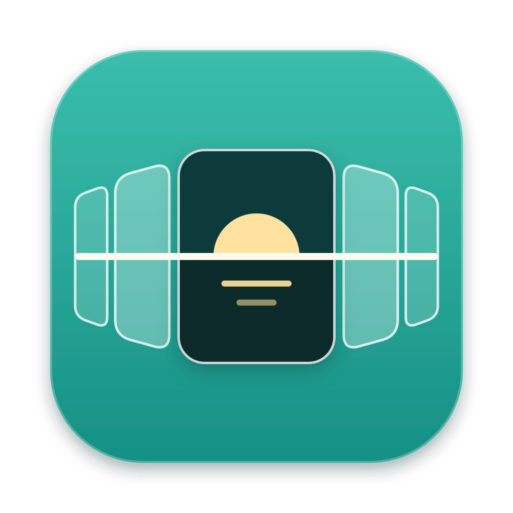
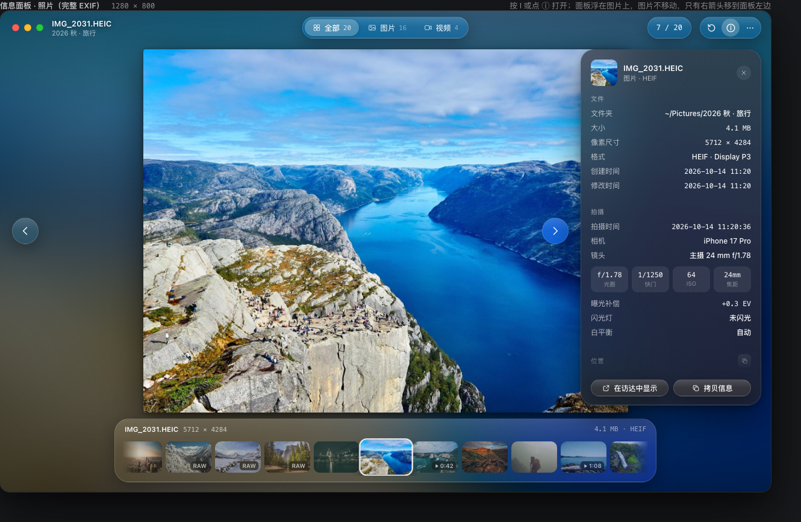

# 一览 Yilan

[中文](#中文) | [English](#english)

<p align="center"></p>


---

## 中文

**一览（Yilan）** 是一款 macOS 看图和看视频的小工具：打开一张图或一个视频，就能在底部缩略图栏里翻看整个文件夹，方向键秒切，RAW 也能秒开。

### 界面预览

下图是设计稿渲染图（用的是开源示意图）：



### 功能

- 打开一张图或视频，自动列出同文件夹里所有支持的图片和视频，按文件名自然排序
- 顶部切换「全部 / 只看图片 / 只看视频」，显示各类数量
- 底部悬浮缩略图栏，上千个文件也流畅；缩略图在后台生成并缓存
- 预加载前后几张，方向键、滚轮、箭头、点击缩略图都能切换
- 支持 JPEG、PNG、WebP、HEIC/HEIF、GIF（动图）、SVG、TIFF、BMP，以及各品牌相机 RAW（先显示内嵌预览，再后台解码高清版）
- 支持 MP4、M4V、MOV（含 iPhone 的 HEVC 视频）播放，有悬浮控制条
- 缩放、拖动、双击在「适应窗口」和「实际大小」之间切换，旋转
- v0.2 新增：信息面板（按 I，文件信息和 EXIF 拍摄信息）、移到废纸篓并可 ⌘Z 撤销、全屏（按 F）、文件夹变化自动同步（新文件带高亮）、按设计稿分组的快捷键设置页
- 界面语言：简体中文、English

### 系统要求

- macOS 26（Tahoe）或更高版本
- Apple 芯片和 Intel 芯片的 Mac（发布包是通用二进制）

### 下载安装

1. 到 [GitHub Releases](https://github.com/paddychenc75/yilan/releases) 下载最新的 `Yilan-<版本>.zip`，解压后把 `Yilan.app` 拖进「应用程序」文件夹。
2. 这个 App 只做了 ad-hoc 签名，没有 Apple 开发者账号签名，也没有公证，所以第一次打开时 macOS 会提示「无法验证开发者」。有两种解决办法，任选一种：
   - **图形界面：** 先双击打开一次（会被拦下），然后到「系统设置 › 隐私与安全性」，往下找到关于 Yilan 的提示，点「仍要打开」。
   - **命令行：** 在终端执行
     ```sh
     xattr -dr com.apple.quarantine /Applications/Yilan.app
     ```
3. 之后就可以正常打开了。

可以用 `shasum -a 256 Yilan-<版本>.zip` 对照 Release 页面上的校验和。

### 从源码构建

需要 Xcode（支持 macOS 26 SDK）和 [XcodeGen](https://github.com/yonaskolb/XcodeGen)（`brew install xcodegen`）。

```sh
cd app
xcodegen generate
xcodebuild -project Yilan.xcodeproj -scheme Yilan -configuration Release \
  -derivedDataPath build/release build
```

运行测试：

```sh
xcodebuild -project Yilan.xcodeproj -scheme Yilan -destination 'platform=macOS' test
```

打发布包（Release 构建、ad-hoc 签名、打成 zip、输出 SHA-256，结果在 `dist/`）：

```sh
scripts/release.sh
```

### 测试素材和图片来源

- `app/Fixtures/` 里的测试样例全部是 CC0 或公共领域的素材，来源见 [app/Fixtures/CREDITS.md](app/Fixtures/CREDITS.md)。其中的相机 RAW 样张太大，没有放进仓库，下载地址也在这份清单里。
- `design/photos/` 里设计稿用的示意图来自 Unsplash（通过 Lorem Picsum），见 [design/photos/CREDITS.md](design/photos/CREDITS.md)。

### 许可证

[MIT](LICENSE)，Copyright (c) 2026 PaddyChen。素材各自的许可见上面的来源说明。

---

## English

**Yilan (一览)** is a small image and video viewer for macOS. Open one file and browse the whole folder from a thumbnail strip at the bottom. Arrow keys switch instantly, and camera RAW files open fast.

### Preview

The screenshot below is a design board render, using open-licensed placeholder photos:


### Features

- Open one image or video and the app lists every supported file in that folder, in natural filename order
- Switch between All / Images only / Videos only, with counts
- Floating thumbnail strip that stays smooth with thousands of files; thumbnails are generated in the background and cached
- Neighbouring files are preloaded; switch with arrow keys, scroll wheel, on-screen arrows or by clicking a thumbnail
- JPEG, PNG, WebP, HEIC/HEIF, GIF (animated), SVG, TIFF, BMP and camera RAW from many brands (the embedded preview shows first, the full decode replaces it in the background)
- MP4, M4V and MOV playback (including iPhone HEVC video) with a floating control bar
- Zoom, pan, double-click to toggle fit-to-window and actual size, rotate
- New in v0.2: info panel (press I: file info and EXIF), move to Trash with ⌘Z undo, full screen (press F), live folder sync (new files are highlighted), and a keyboard shortcuts page in Settings
- UI languages: Simplified Chinese and English

### Requirements

- macOS 26 (Tahoe) or later
- Apple silicon and Intel Macs (the release build is a universal binary)

### Download and install

1. Download the latest `Yilan-<version>.zip` from [GitHub Releases](https://github.com/paddychenc75/yilan/releases), unzip it and drag `Yilan.app` into your Applications folder.
2. The app is only ad-hoc signed. It is not signed with an Apple Developer ID and not notarized, so the first time you open it macOS will say it cannot verify the developer. There are two ways around that; use either one:
   - **GUI:** double-click the app once (it will be blocked), then open System Settings › Privacy & Security, scroll down to the message about Yilan and click "Open Anyway".
   - **Command line:** run
     ```sh
     xattr -dr com.apple.quarantine /Applications/Yilan.app
     ```
3. After that it opens normally.

You can compare `shasum -a 256 Yilan-<version>.zip` with the checksum on the Release page.

### Build from source

You need Xcode with the macOS 26 SDK and [XcodeGen](https://github.com/yonaskolb/XcodeGen) (`brew install xcodegen`).

```sh
cd app
xcodegen generate
xcodebuild -project Yilan.xcodeproj -scheme Yilan -configuration Release \
  -derivedDataPath build/release build
```

Run the tests:

```sh
xcodebuild -project Yilan.xcodeproj -scheme Yilan -destination 'platform=macOS' test
```

Build the release package (Release build, ad-hoc signing, zip, SHA-256; output goes to `dist/`):

```sh
scripts/release.sh
```

### Test media and image credits

- The test samples in `app/Fixtures/` are all CC0 or public domain; sources are listed in [app/Fixtures/CREDITS.md](app/Fixtures/CREDITS.md). The camera RAW samples are too large for the repo; their download links are in the same file.
- The placeholder photos used in the design boards (`design/photos/`) come from Unsplash via Lorem Picsum; see [design/photos/CREDITS.md](design/photos/CREDITS.md).

### License

[MIT](LICENSE), Copyright (c) 2026 PaddyChen. Media files keep the licenses listed in the credits above.
